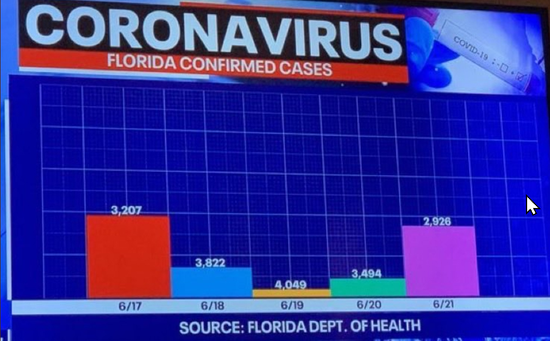
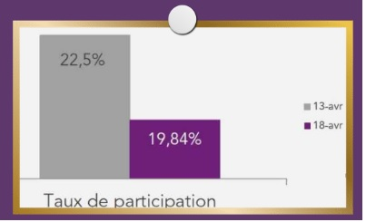
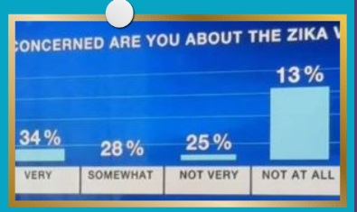

Infographie Trompeuse : Sony DIRIL 
=====

# 1ère infographie

Dans cette première infographie qui traite du coronavirus, il y a un problème d'échelle, en effet l'infographie est trompeuse, la barre de la première valeur du 6/17 qui a pour valeur "3,207" est plus grande que celle du 6/19 qui a pour valeur "4.049". À la place, j'aurais simplement initialisé mon échelle à 0.

# 2ème infographie

Dans cette infographie qui traite du taux de participation (nous n'avons pas l'information de quelle participation il s'agit ici). Il y a aussi un problème d'échelle, l'écart entre 22,5% et 19,84%  est trop énorme (seulement 2-3 pourcent de différence pourtant l'écart est énorme). Il y a aussi un problème de nombre après la virgule, la valeur du 13 avril (barre grise) nous avons seulement un chiffre après la virgule, contrairement au 18 avril où nous avons deux chiffres après la virgule. À la place, j'aurais ajusté l'écart et pris à chaque fois 2 chiffres après la virgule ou tout arondir à 1 chiffre après.

# 3ème infographie

Dans cette infographie (nous n'avons aucun contexte), le 28% n'a pas de barre, les échelles ne sont pas respectées, le 13% est beaucoup trop grand par rapport au reste des pourcentages, à la place j'aurais ajusté les échelles et ajouté la barre des 28% donc de "SOMEWHAT".

